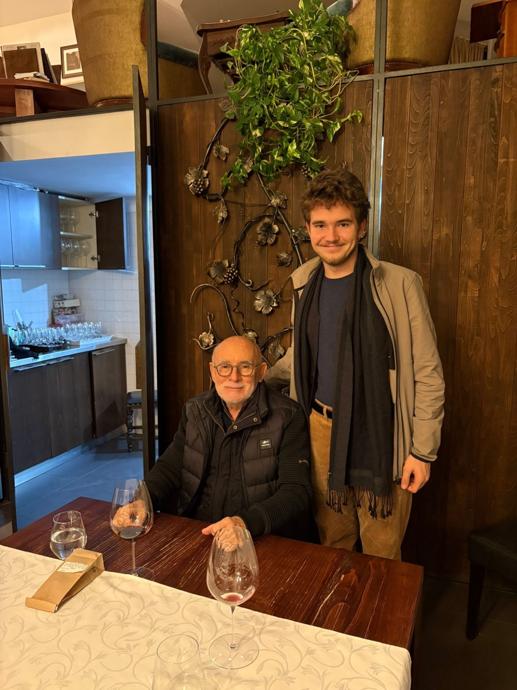

Podrum Radovanović has received its reviews from James Suckling, and they are excellent.

Mija Radovanović himself is still working, caring for his wines and experimenting with new ideas, especially with rosé. Truly one of the greats of Serbian winemaking.

## A 98 for the Grand Reserve

The winery's flagship, the **Cabernet Sauvignon Grand Reserve**, earned **98/100**: the highest score of any Serbian wine. That is a score you normally only see next to far more expensive bottles. The only comparison in Serbia is Kremen Kamen.

## Every wine above 90

Every single wine in the tasting scored **90 or more**. That says a lot about the value for money across the whole range, and it backs up just how good the Grand Reserve is.

## Tasting with the winemaker

I had the honour of trying these revered wines alongside the person who made them, especially the still unreleased **2022 Grand Reserve** and the **Prokupac**, his new idea. The difference between the Grand Reserves of different years is striking, even for my unassuming taste: the 2022 has more chocolate in its aroma. I strongly recommend trying it when it comes out.

## How I would taste them

Together, these wines make a perfect tasting of the winery's work through the years. To go with them:

- **Reds:** some very tender meat.
- **Whites:** simple mezze.
